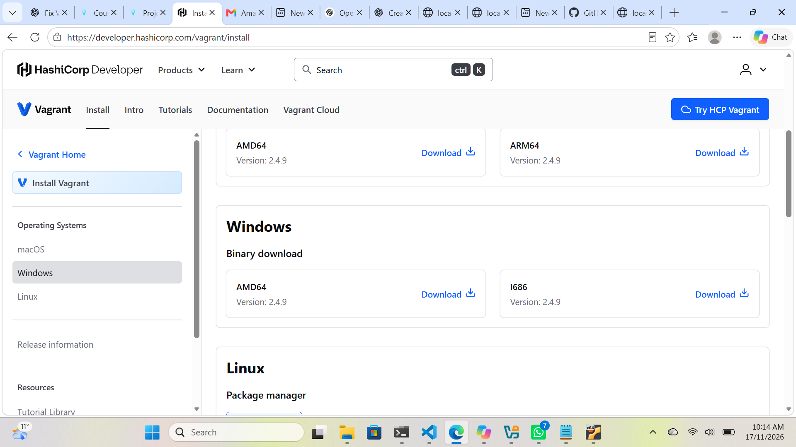
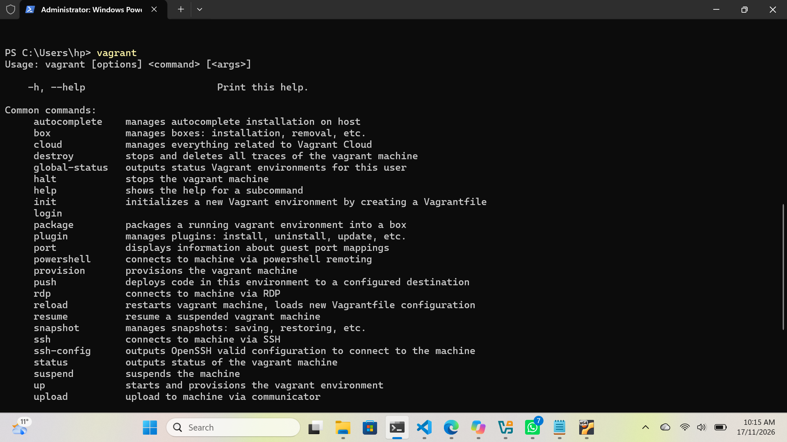
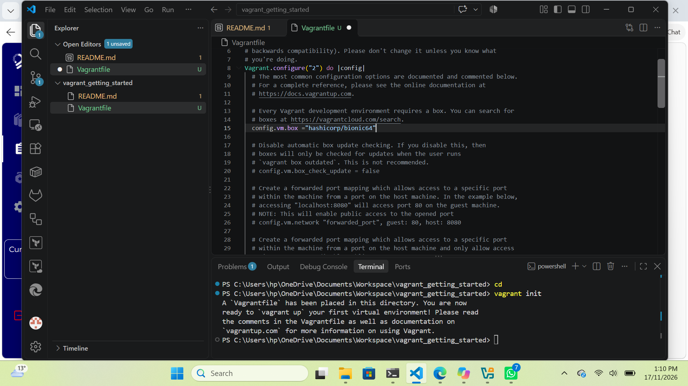
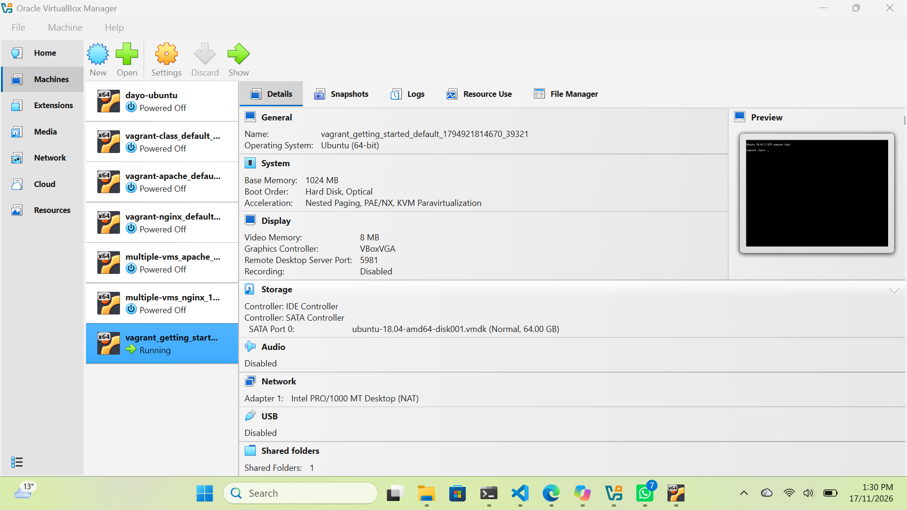
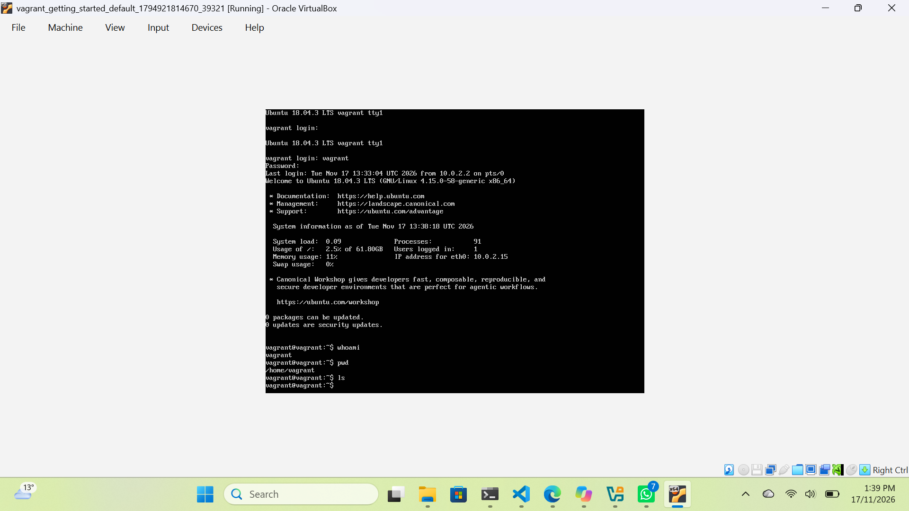

# Getting Started with Vagrant

## 1. Install Vagrant

To start using Vagrant, you first need to install it on your machine.

### Visit the Vagrant Downloads Page

Visit the official [Vagrant Downloads Page](https://developer.hashicorp.com/vagrant/install) to download Vagrant.

Choose the appropriate version for your operating system (Windows, macOS, or Linux) and follow the installation instructions.



### Install Using the Command Line

If you prefer using the command line (CLI), you can download and install Vagrant through your terminal. You should see output indicating the download progress and completion.

### Installation Guides

You can also follow the installation guides for your operating system:

- [Install Vagrant on macOS](https://developer.hashicorp.com/vagrant/install)
- [Install Vagrant on Windows](https://developer.hashicorp.com/vagrant/install)

---

## 2. Verify the Installation

After installation, it is important to confirm that Vagrant was installed correctly.

### Open Command Prompt or Terminal

- **Windows:** Search for "Command Prompt" in the Start menu and open it.
- **macOS/Linux:** Open the Terminal application.

### Check Vagrant Installation

In your command prompt or terminal, type the following command and press Enter:

```bash
vagrant
```

**Expected Output:** You should see a list of Vagrant commands and available options.



If you see an error saying `Vagrant not found`, try logging out and logging back in (especially on Windows) to refresh your system's environment variables.

## 3. Create a Directory for Your Project

Before you start working with Vagrant, it is good practice to create a dedicated folder for your project.

### Create a New Directory

Run the following command to create a new directory named `vagrant_getting_started`:

```bash
mkdir vagrant_getting_started
```

You can check that the directory was created using:

```bash
ls
```

### Navigate into Your New Directory

Change into your newly created directory:

```bash
cd vagrant_getting_started
```

## 4. Initialize the Vagrant Project

Now that you are inside your project directory, you need to initialize Vagrant.

### Run the Initialization Command

Use the following command to initialize your Vagrant project:

```bash
vagrant init
```

**What this does:** This command creates a `Vagrantfile`, which is a configuration file that defines your virtual machine settings.

Take a moment to open the `Vagrantfile` in a text editor to explore its structure.

## 5. Configure Your Vagrantfile

To set up your virtual machine, you need to specify which base box to use in your `Vagrantfile`.

### Open the Vagrantfile

Use any text editor, such as Notepad, VS Code, or Atom, to open the `Vagrantfile`.

### Modify the Vagrantfile

Replace the existing contents with the following code:

```ruby
Vagrant.configure("2") do |config|
  config.vm.box = "hashicorp/bionic64"
end
```

**Explanation:** The line `config.vm.box = "hashicorp/bionic64"` tells Vagrant to use the `hashicorp/bionic64` box as the base for your virtual machine.

If this box has not already been downloaded, Vagrant will automatically download it when you start the virtual machine.



## 6. Start Your Virtual Machine

**Before starting your virtual machine, make sure Oracle VirtualBox is installed and available on your machine.**

With your `Vagrantfile` configured, you can now start your virtual machine.

### Run the Command

Type the following command in your terminal:

```bash
vagrant up
```

**What this command does:** This command downloads the specified base box (if it is not already on your machine) and creates a new virtual machine instance based on your configuration.

The process may take a few minutes, depending on your internet connection and system performance.



### Accessing Your Virtual Machine

Once the virtual machine is up and running, you can log into it using:

```bash
vagrant ssh
```

**What this command does:** This opens a secure shell (SSH) session inside the virtual machine, allowing you to run commands and interact with the VM as if you were using it directly.



## 7. Stopping and Destroying the Virtual Machine

When you are finished working with your virtual machine, you can stop or remove it to free up system resources.

### Stop the Virtual Machine

Open a terminal in the same project directory and run:

```bash
vagrant halt
```

**Explanation:** This command gracefully shuts down the virtual machine without deleting it. You can start it again later using:

```bash
vagrant up
```

### Completely Remove the Virtual Machine

If you want to free up resources and delete the virtual machine, use:

```bash
vagrant destroy
```

**Confirmation:** You will be prompted to confirm that you want to destroy the VM. Type `y` (yes) to proceed.

**Note:** This removes the virtual machine, but it does not delete your `Vagrantfile` or project directory.

---

## Summary: Essential Vagrant Commands

| Command | Description |
|---|---|
| `vagrant` | Displays available Vagrant commands |
| `vagrant init` | Initializes a Vagrant project |
| `vagrant up` | Creates and starts the virtual machine |
| `vagrant ssh` | Connects to the virtual machine |
| `vagrant halt` | Stops the virtual machine |
| `vagrant destroy` | Removes the virtual machine |
| `vagrant status` | Checks the current VM status |

**Congratulations!** You have successfully gone through the basic steps of installing Vagrant, configuring a virtual machine, accessing it, and managing its lifecycle.
